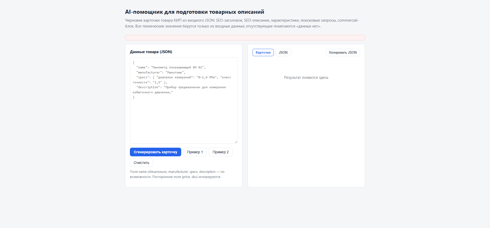
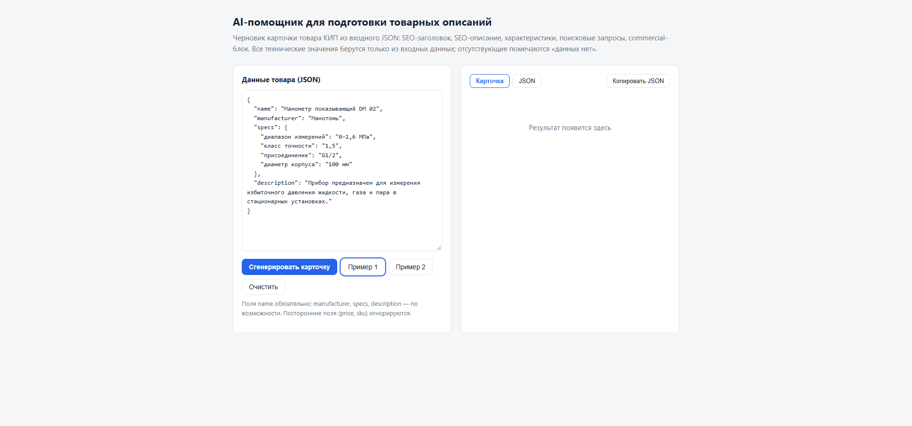
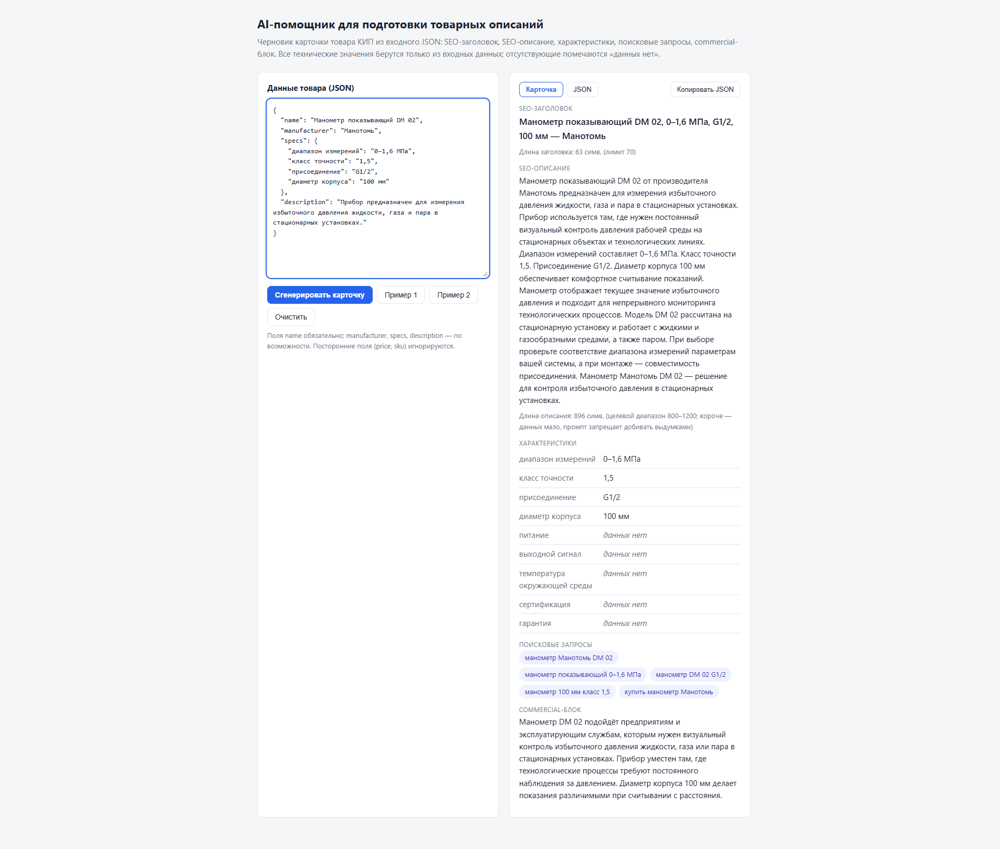
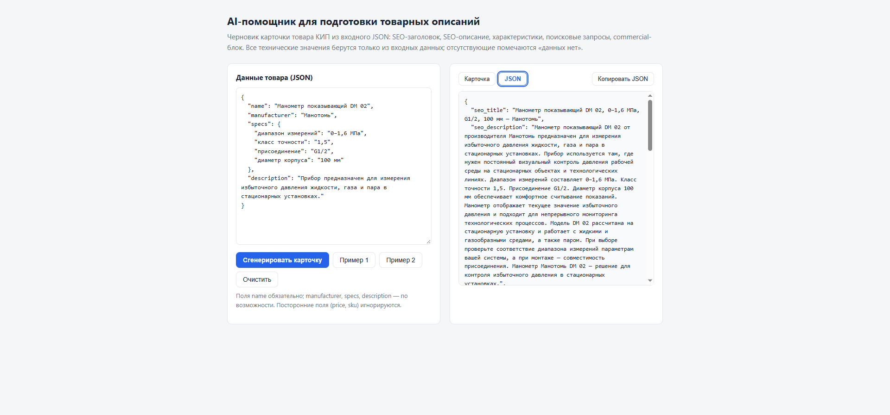
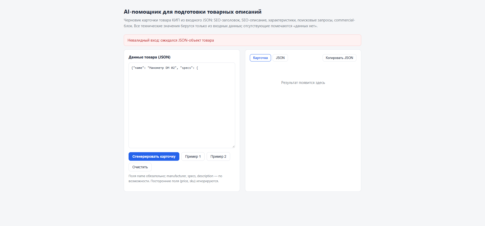
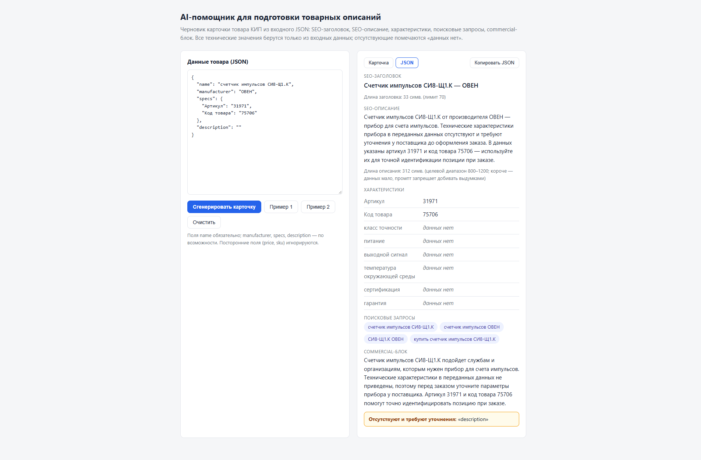

# Пошаговая инструкция по использованию (со скриншотами)

Все скриншоты сняты с работающего сервиса (`uvicorn app.main:app`, модель glm-5.3-flash).
Файлы кадров: `docs/screenshots/`.

## Шаг 0. Запуск

```bash
pip install -r requirements.txt
cp .env.example .env        # вписать LLM_API_KEY (любой OpenAI-совместимый провайдер)
uvicorn app.main:app
```

Открыть http://127.0.0.1:8000

## Шаг 1. Открыть форму

Слева — поле данных товара (JSON), справа — панель результата. `name` обязательно;
`manufacturer`, `specs`, `description` — по возможности.



## Шаг 2. Вставить данные товара

Вставьте JSON товара в поле вручную или нажмите **«Пример 1» / «Пример 2»** —
подставятся товары из задания (кнопки загружают их с сервера, `GET /api/examples`).



## Шаг 3. Сгенерировать карточку

Нажмите **«Сгенерировать карточку»**. Один вызов LLM (~30–60 с в зависимости от
провайдера), справа появляется черновик карточки:

- **SEO-заголовок** — с индикатором длины (лимит 70 символов);
- **SEO-описание** — 800–1200 символов; если данных мало, описание короче,
  но никогда не «добивается» выдумками;
- **Характеристики** — таблица: значения из входа дословно + обязательные разделы
  КИП; то, чего во входе нет, помечено курсивом «данных нет»;
- **Поисковые запросы** — 3–5 чипов под SEO-оптимизацию страницы;
- **Commercial-блок** — кому подходит прибор и какие задачи решает;
- жёлтая плашка **«Отсутствуют и требуют уточнения»** — список пустых полей входа
  (`missing_fields`) — контент-менеджеру видно, что запросить у поставщика.



## Шаг 4. Скопировать результат

Вкладка **«JSON»** показывает карточку в исходном виде — кнопка **«Копировать JSON»**
кладёт её в буфер обмена одним нажатием для вставки в CMS или таблицу.



## Шаг 5. Некорректный вход

Битый JSON, неверная структура или отсутствие `name` отклоняются **до вызова модели**:
красный баннер с понятной причиной, код ответа 400, токены не тратятся.



## Шаг 6. Товар с неполными данными

«Пример 2» — реальный товар каталога с разреженным входом (название, производитель,
артикул и код, без описания): карточка честно помечает отсутствующие характеристики
«данных нет» и рекомендует уточнить параметры у поставщика — никаких
«правдоподобных» значений.



## Без формы — через API

```bash
curl -X POST http://127.0.0.1:8000/api/card \
  -H "Content-Type: application/json" \
  -d @data/products/01-manometr-dm02.json
```

Коды ответов: `200` — карточка; `400` — некорректный вход; `422` — вход корректен,
но товар не относится к КИП (вердикт модели); `502` — ошибка LLM API; `503` — не задан ключ.
Полный контракт — в [README](../README.md).
